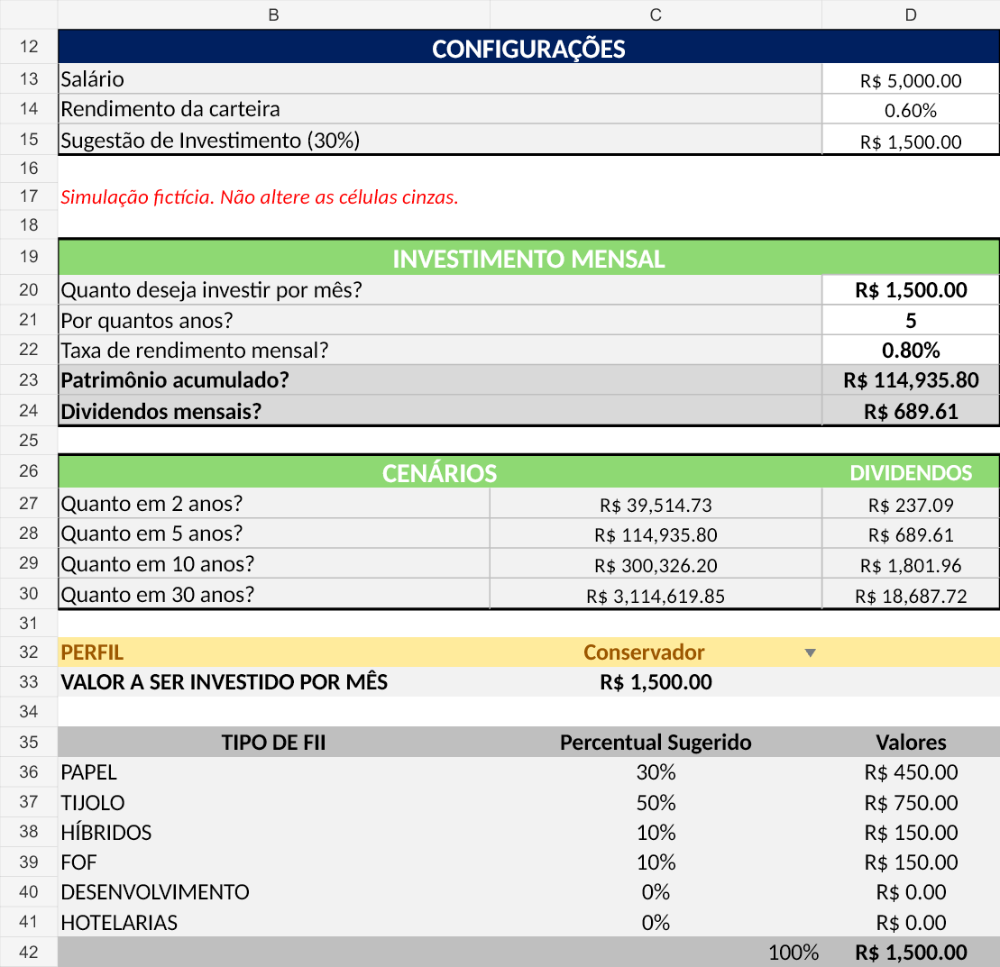
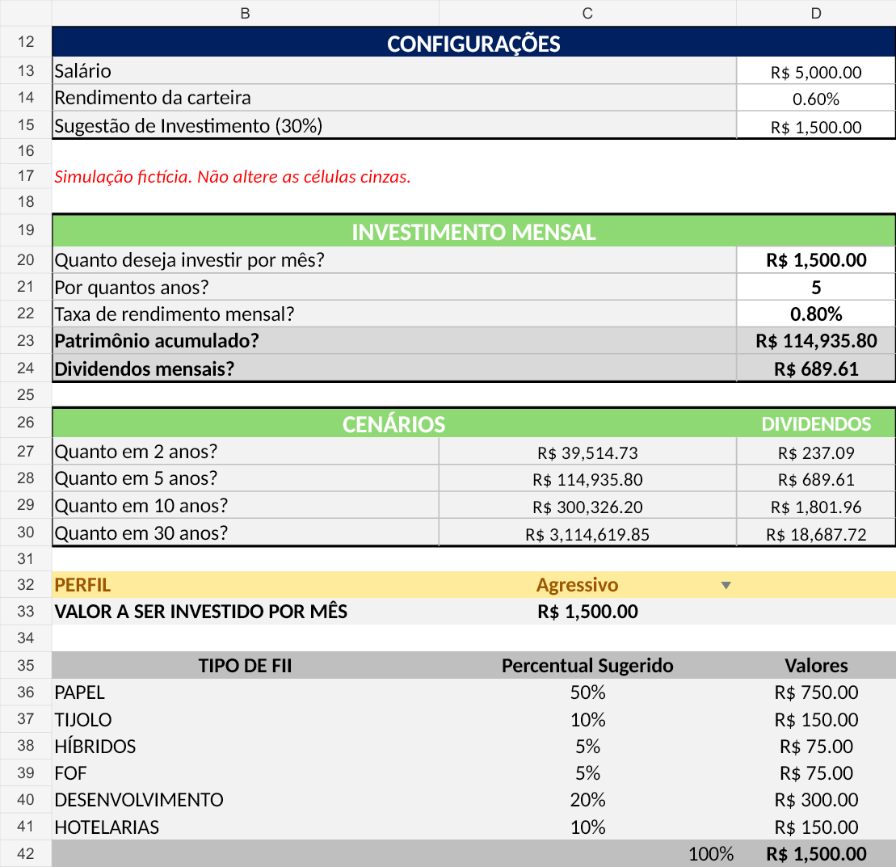
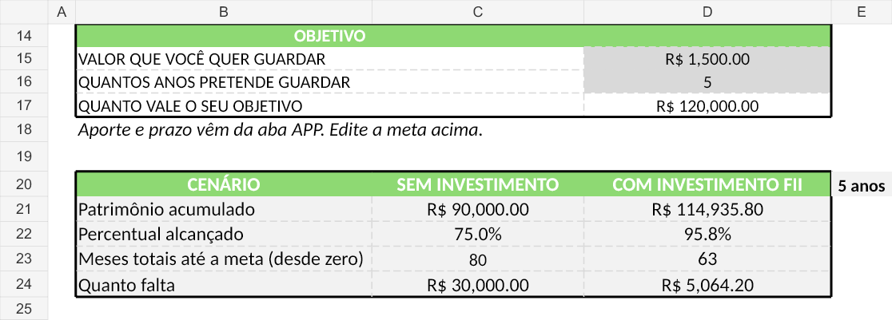

# Simulador de investimentos em Excel

Projeto de estudo da DIO, desenvolvido a partir da ferramenta do Expert e ampliado com uma comparação para objetivos financeiros. A planilha calcula patrimônio, dividendos estimados e distribuição do aporte entre tipos de fundos imobiliários.

[Abrir ou baixar a planilha](simulador-investimentos.xlsx)

Todos os valores de entrada desta versão são fictícios: salário de R$ 5.000, aporte de R$ 1.500 por mês, prazo de 5 anos e objetivo de R$ 120.000. As taxas de 0,80% ao mês para acumulação e 0,60% ao mês para estimar dividendos são hipóteses didáticas. O modelo usa taxas constantes, sem descontar inflação, custos ou tributos. A alocação por perfil não altera automaticamente a rentabilidade assumida.

## As cinco perguntas e onde encontrar as respostas

| Pergunta | Onde aparece | Exemplo preenchido |
|---|---|---|
| Quanto investir por mês? | APP!D15 sugere 30% do salário; APP!D20 recebe o aporte escolhido | R$ 1.500 |
| Por quantos anos investir? | APP!D21, prazo definido pelo usuário | 5 anos |
| Qual taxa de rendimento mensal utilizar? | APP!D22, hipótese definida pelo usuário | 0,80% ao mês |
| Qual será o patrimônio acumulado? | APP!D23 | R$ 114.935,80 |
| Qual será o dividendo mensal estimado? | APP!D24, usando a taxa de APP!D14 | R$ 689,61 |

Prazo e taxa são entradas da simulação, não previsões calculadas pela ferramenta. A aba APP também responde quanto se acumularia em 2, 5, 10 e 30 anos em C27:D30 e como distribuir o aporte por perfil em C36:D41.

A aba Objetivo compara o mesmo aporte e prazo com e sem rendimento. C21:D24 mostram patrimônio, percentual da meta, meses totais desde zero para alcançar a meta e valor que ainda falta. No exemplo, o patrimônio sem rendimento é R$ 90.000 (75% da meta); com rendimento, R$ 114.935,80 (95,78%). O prazo total para atingir R$ 120.000 é de 80 meses sem rendimento e 63 meses com rendimento.

## Como usar

1. Baixe o arquivo e abra no Excel.
2. Na aba APP, ajuste D13 (salário), D14 (taxa para dividendos), D20 (aporte), D21 (anos) e D22 (rendimento mensal).
3. Escolha Conservador, Moderado ou Agressivo na lista de APP!C32. A distribuição e o gráfico acompanham o perfil selecionado.
4. Na aba Objetivo, informe a meta em D17. Aporte e prazo vêm automaticamente da aba APP.
5. Confira o total de 100% em APP!C42 e o valor total em D42. Preserve as células de fórmulas.

Use entradas numéricas válidas: aporte positivo, prazo não negativo, meta positiva e taxas mensais não negativas. O caso de taxa zero também foi testado.

## VF e PROCV nos cálculos

Em APP!D23, a fórmula em Excel português é:

```excel
=VF(taxa_mensal;qtd_anos*12;aporte*-1)
```

`VF` calcula o valor futuro de aportes mensais iguais. Os anos são multiplicados por 12 e o aporte recebe sinal negativo por representar saída de dinheiro. Com os argumentos opcionais omitidos, o saldo inicial é zero e os aportes ocorrem no fim do mês. As projeções de C27:C30 usam a mesma lógica para outros prazos. Os dividendos de D24 são `=patrimonio*rendimento_carteira`, uma estimativa mensal sobre o patrimônio final, sem somar essa estimativa novamente ao VF.

Em APP!C36:

```excel
=PROCV($C$32&"-"&B36;apoio!$A:$D;4;FALSO)
```

`PROCV` combina o perfil e o tipo de FII, procura a chave na primeira coluna de apoio e retorna o percentual da quarta coluna. `FALSO` exige correspondência exata. Por exemplo, `Conservador-PAPEL` retorna 30%. A fórmula de D36, `=C36*$C$33`, converte esse percentual em reais. Essa lógica segue até a linha 41.

O arquivo XLSX armazena os nomes invariantes `FV` e `VLOOKUP`, que o Excel em português apresenta como `VF` e `PROCV`. A aba Objetivo também usa `NPER` para calcular o número de meses até a meta e arredonda o prazo para cima.

## Intervalos nomeados

Os nomes abaixo se referem a células individuais. Sete já existiam no arquivo do Expert; `qntd_obj` foi acrescentado na planilha desenvolvida para o projeto.

| Nome | Referência nesta versão | Finalidade | Origem |
|---|---|---|---|
| salario | APP!D13 | Salário informado | Expert |
| rendimento_carteira | APP!D14 | Taxa mensal para estimar dividendos | Expert |
| sugestao_investimento | APP!D15 | Sugestão de 30% do salário | Expert |
| aporte | APP!D20 | Aporte mensal | Expert |
| qtd_anos | APP!D21 | Prazo em anos | Expert |
| taxa_mensal | APP!D22 | Taxa mensal de acumulação | Expert |
| patrimonio | APP!D23 | Resultado do VF | Expert |
| qntd_obj | Objetivo!D17 | Valor da meta | Acrescentado no projeto |

Os endereços da aba APP foram ajustados em relação ao Expert devido às mudanças de layout. O nome interno de filtro do Excel não é um intervalo de cálculo criado para o modelo.

## Percentuais e origem dos perfis

| Tipo de FII | Conservador | Moderado | Agressivo |
|---|---:|---:|---:|
| Papel | 30% | 32% | 50% |
| Tijolo | 50% | 35% | 10% |
| Híbridos | 10% | 8% | 5% |
| FOF | 10% | 5% | 5% |
| Desenvolvimento | 0% | 10% | 20% |
| Hotelarias | 0% | 10% | 10% |
| **Total** | **100%** | **100%** | **100%** |

Fonte: arquivo do Expert fornecido para comparação, `a04b81b1-8e35-4e72-aeb9-98aed8ed4403.xlsx`, aba Planilha2, B3:D20. Os 18 percentuais foram conferidos e mantidos integralmente em apoio!B3:D20. São parâmetros do exercício, não percentuais derivados de pesquisa de mercado nem uma recomendação personalizada. O arquivo de referência não informa metodologia externa para esses pesos.

## O que mudou em relação ao Expert

Comparação direta entre o arquivo do Expert fornecido e a planilha do projeto:

- Inclusão da aba **Objetivo**, com meta financeira, comparação com e sem rendimento, percentual alcançado, prazo e saldo faltante.
- Criação do nome **qntd_obj** para o valor da meta.
- Renomeação de **Planilha2** para **apoio** e atualização das referências de busca.
- Alterações de identidade visual, layout e instruções de preenchimento.
- Padronização da categoria **FOFs** para **FOF** na tabela e na busca.
- A lista de cenários do projeto contém 2, 5, 10 e 30 anos; a referência também incluía 20 anos.
- Preservação das fórmulas centrais de VF, PROCV e dos percentuais do Expert.

Na revisão para publicação, foram feitas ainda estas correções na cópia do projeto:

- Uso de dados fictícios identificados na aba APP.
- Vinculação do aporte e prazo de Objetivo aos valores de APP, para comparar a mesma simulação.
- Substituição de PERCENTOF por divisão, evitando dependência dessa função mais recente.
- Padronização dos dois prazos da meta como **meses totais desde zero**. Antes, a coluna sem rendimento mostrava meses restantes e a coluna com rendimento mostrava prazo total.
- Exibição de saldo faltante mínimo de zero quando a meta já foi alcançada.
- Inclusão do total de percentuais em APP!C42 e correção do texto “Sugestão de Investimento”.

## Evidências: a mesma simulação em dois perfis

As imagens abaixo são renderizações das células preenchidas e recalculadas, não capturas da interface do Excel. Elas usam os mesmos valores de entrada, alterando apenas APP!C32. O arquivo exportado também foi aberto e recalculado no Excel instalado.

### Conservador



### Agressivo



| Tipo | Conservador | Agressivo |
|---|---:|---:|
| Papel | R$ 450,00 | R$ 750,00 |
| Tijolo | R$ 750,00 | R$ 150,00 |
| Híbridos | R$ 150,00 | R$ 75,00 |
| FOF | R$ 150,00 | R$ 75,00 |
| Desenvolvimento | R$ 0,00 | R$ 300,00 |
| Hotelarias | R$ 0,00 | R$ 150,00 |
| **Total** | **R$ 1.500,00** | **R$ 1.500,00** |

O patrimônio e os dividendos permanecem iguais entre os perfis porque as taxas são entradas fixas da simulação. O que muda é a distribuição do aporte.

### Comparação com a meta



## Verificações realizadas

- Abertura e recálculo do arquivo exportado no Microsoft Excel instalado, sem erros de fórmula ou números truncados nas células verificadas.
- Lista de perfis preservada como validação de dados do tipo lista.
- Troca entre os três perfis e conferência de soma de 100% e total de R$ 1.500.
- Conferência independente do VF pela expressão `aporte*((1+taxa)^meses-1)/taxa`.
- Teste de taxa zero: patrimônio de R$ 90.000 em 60 meses e 80 meses para atingir a meta de R$ 120.000.
- Inspeção visual das imagens e conferência da origem dos percentuais e dos nomes.

Os testes cobrem os cenários descritos; não constituem garantia para qualquer entrada inválida ou versão de aplicativo.
